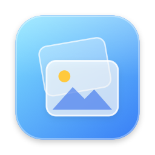

# Shelfie



*Formerly Screenshot Dock.*

A Mac app that keeps screenshots off your Desktop and one click away in the Dock.

- **Pick where each screenshot goes** with a quick-choice bar that appears right after you take it.
- **Grab them from the Dock.** Click the Dock icon for a shelf of your screenshots, newest first. Drag one into any app.
- **Names you can read.** Apple's on-device text recognition and AI rename each screenshot from what's in it, like `Youth Soccer Schedule – Oct 13, 4.27 PM.png`. Nothing leaves your Mac.

## ⬇️ [Download Shelfie for Mac](https://github.com/hi-dad/shelfie/releases/latest/download/Shelfie.dmg)

Needs macOS 26 or newer. Works on Apple Silicon and Intel Macs. This link always gets the newest version.

## Install

1. Open the downloaded **Shelfie.dmg**.
2. Drag **Shelfie** onto the **Applications** folder in that window. (Don't open it from inside this window.)
3. Open **Applications** and double-click **Shelfie**.
4. In the shelf that opens, click **Set up…** and choose or create an empty holding folder (see [Setup](#setup)).

### The first time you open it

Your Mac will say it can't verify the app. That's normal for apps that aren't from the App Store, and you only need to do this once.

1. Click **Done**. Don't click Move to Trash.
2. Open **System Settings**, click **Privacy & Security**, scroll down, and click **Open Anyway** next to Shelfie. Enter your Mac password if asked.
3. Click **Open** on the last prompt. From now on Shelfie opens normally.

If you don't see **Open Anyway**, try opening Shelfie once more, then go straight back to Privacy & Security. The button only appears for about an hour after the app is blocked.

**To update:** download again and replace the copy in Applications. Your categories, folders and settings stay.

**To uninstall:** open the shelf → gear → **Turn off** (puts macOS screenshots back on the Desktop), then **Quit Shelfie** and drag it from Applications to the Trash.

## The quick-choice bar

After each screenshot, press a number (or click). If you do nothing for 6 seconds, or press Esc, it goes to your default choice (Desktop until you change it).

Taking several screenshots in a row? While the bar is showing, each new one joins the same batch (the bar shows a count and the timer restarts), and one choice files them all.

| Key | Starts as | What it does |
|---|---|---|
| **1** | Desktop | Loose on your Desktop |
| **2** | Save | Your folder, chosen the first time you press it |
| **3** | Inspiration | Your folder, chosen the first time you press it |
| **4** | Records | Your folder, sorted into a sub-folder per year |
| **5** | Photos | Added to Apple Photos (syncs to your iPhone) |

## Make the choices yours

Open the shelf → gear → **Where screenshots go**.

- **2, 3 and 4** are yours: rename them, pick an icon, choose any folder on your Mac, turn on "New folder each year", or switch one off to hide it from the bar.
- **Photos** can also keep a copy of the file in a folder. Without one, the file goes to the Trash once it's safely in Photos.
- **If you don't choose** sets the default used after 6 seconds or Esc.

Folders are followed if you move or rename them. If one is deleted, its screenshots go to the Desktop and the shelf shows an alert (with a **!** on the Dock icon) so you can pick a new one.

## The shelf

- **Click the Dock icon** to open it, or **hold ⌥`** (Option + backtick) to peek at it under your mouse. Tap the key to keep it open.
- **Drag a screenshot out** and it leaves the shelf. The file stays in its folder.
- **Pin** keeps a screenshot on the shelf. **✕** removes it from the shelf only.
- **Recently removed** at the bottom brings back anything you took off by mistake.
- Delete a file in Finder and it disappears from the shelf too.
- Right-click the Dock icon for your latest screenshots.
- Settings (gear) → **Text size** and **Shelf size**: Small, Medium, Large or Extra large.
- Settings (gear) → **Screenshots per row**: 2, or 1 for larger previews. With 1 per row, pick how screenshots are separated: a divider line (image only) or a caption bar with the name on the image.

## Copy-only screenshots

For screenshots you're about to paste, use macOS's own "Copy picture of selected area to the clipboard" shortcut (System Settings → Keyboard → Keyboard Shortcuts → Screenshots). It never creates a file, so Shelfie stays out of the way.

## Setup

Open the shelf and click **Set up…**, then choose or create an empty folder to be your **holding folder** (Finder's **New Folder** button works). Shelfie doesn't create any folders by itself.

Why it's needed: macOS saves every screenshot as a file before any app can see it, and by default that's on your Desktop. Setup has macOS save them into your holding folder instead and turns off the floating thumbnail, so the choice bar appears right away and nothing flashes onto your Desktop. Shelfie moves each screenshot out of the holding folder as soon as you choose where it goes, so it stays empty. If Shelfie isn't running, screenshots wait there until it opens.

If macOS keeps saving to the Desktop anyway, press ⌘⇧5 → Options → Other Location… and pick your holding folder once (newer macOS versions ask you to confirm this yourself). Settings → **Holding folder** lets you change it, or **Turn off** to put Apple's defaults back.

Requires macOS 26 or newer. Names use Apple Intelligence when it's on, and fall back to the screenshot's largest heading when it isn't.

## Build it yourself

```bash
./build.sh        # builds and installs to /Applications
./build.sh dist   # also makes dist/Shelfie.dmg
```

The whole app is one file: [`main.swift`](main.swift).

## License

[MIT](LICENSE)
