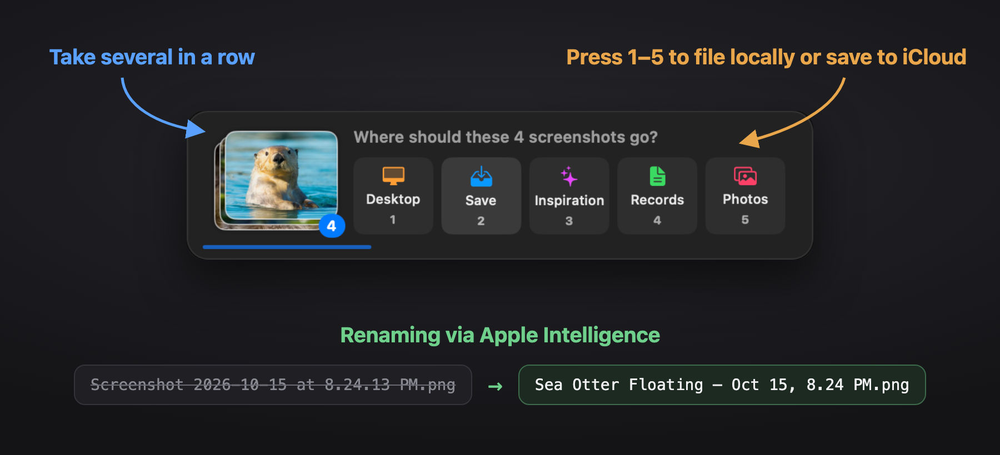

# Shelfie


**A Mac app that keeps screenshots off your Desktop: pick where each one goes the moment you take it, and grab recent ones from the Dock.**




### [⬇️ Download Shelfie](https://github.com/hi-dad/shelfie/releases/latest/download/Shelfie.dmg)
Free · macOS 26 or newer · always the latest version

## Install

1. Open **Shelfie.dmg** and drag Shelfie into **Applications**.
2. Open it, and click **Open** when macOS asks if you're sure. (It's signed and checked by Apple.)
3. In the shelf, click **Set up…** and choose or create an empty **holding folder**. New screenshots wait there for a moment while Shelfie files them.

## How to use it

- **Take a screenshot** and a little bar appears: press **1–5** to choose where it goes (Desktop, your own folders, or Apple Photos). Press **6** to send an accidental one to the Trash. Do nothing and it goes to your default.
- **Click Shelfie in the Dock** for a shelf of recent screenshots. Drag one straight into any app.
- **Readable names:** each screenshot is renamed from what's in it, on your Mac.
- **Make it yours** in Settings: rename keys 2–4, pick icons and folders, choose the default, and set the text and shelf size.

**Update:** download again and replace the app; your settings stay. **Remove:** Settings → **Turn off** (puts screenshots back on the Desktop), then **Quit** and drag it to the Trash.

<details><summary>Build it yourself</summary>

```bash
./build.sh        # builds, installs to Applications and opens it
./build.sh dist   # also makes dist/Shelfie.dmg
```

The whole app is one file: `main.swift`.

</details>

MIT License
